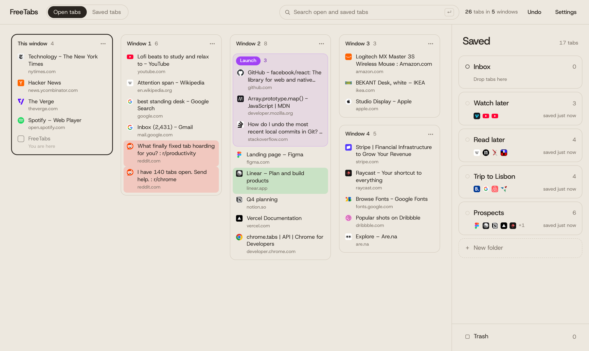
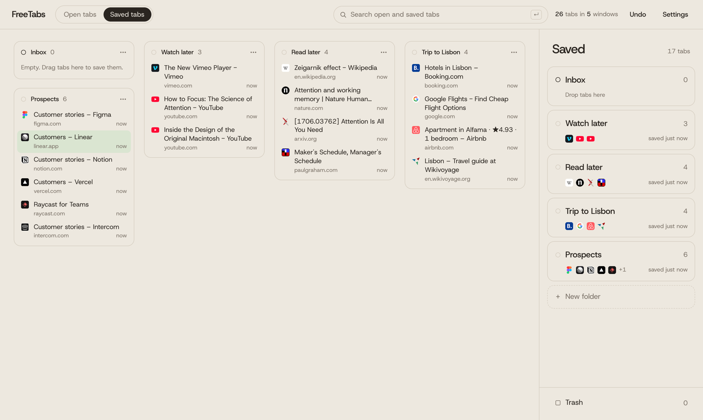
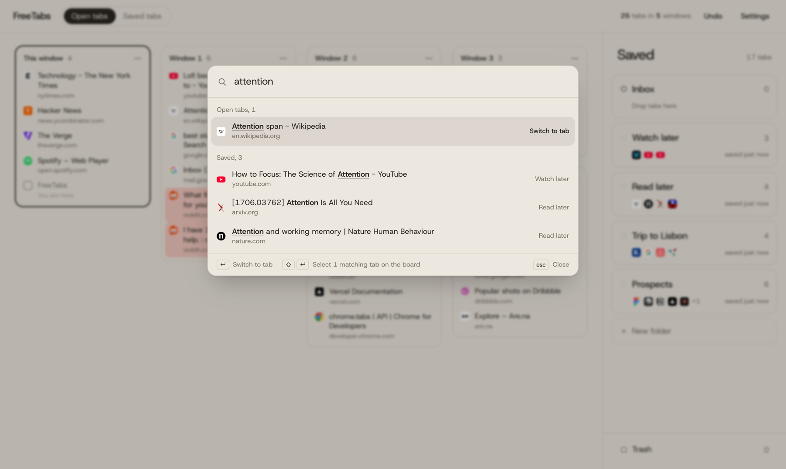
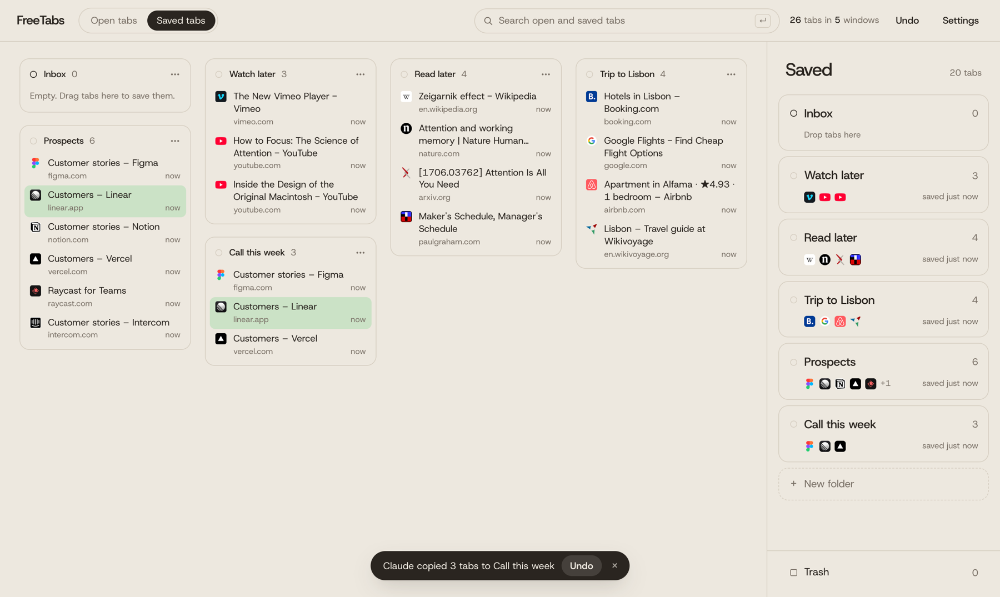

<p align="center">
  
</p>

<h1 align="center">FreeTabs</h1>

<p align="center">
  <strong>Save yourself from 50 open tabs.</strong>
</p>

<p align="center">
  Every tab from every Chrome window on one board.<br>
  Lasso the ones that belong together, drop them on a folder, and they're saved, checked and closed in one move.
</p>

<p align="center">
  Free forever and open source. Your tabs stay on your computer.
</p>

<p align="center">
  <a href="#install"><strong>Install FreeTabs</strong></a>
</p>

<br>

<picture>
  <source media="(prefers-color-scheme: dark)" srcset="docs/board-dark.png">
  
</picture>

## It started with 50 tabs and a lagging Mac

Fifty tabs across ten Chrome windows, each one a mix of projects. Chrome had the Mac lagging, and Activity Monitor showed several of its processes using 600 to 900 MB each. Every tab looked like something we might need, so none of them got closed. Going window by window to sort them took energy we didn't have.

The tools we tried poured everything into one long list. We never sorted those lists, and we never opened them again.

So we built the tool we wanted. It's for people with ADHD, and for anyone whose browser fills up faster than they can sort it.

## Four beliefs, built in

### Closing a tab should never cost you the tab

Tabs pile up because closing one feels like losing it. FreeTabs saves every tab to your folder, reads it back to check, and only then closes it. Pages with unsaved work stay open. Every move can be undone, and a copy of your folders lives in your Chrome bookmarks, so your saved tabs survive even if you uninstall FreeTabs.

### Sort now, because later never comes

Your windows sit side by side, with full titles. Drag a lasso across the tabs that belong together, across windows if you like, and drop them on a folder. Watch later and Read later are there from the start, and keys 1 to 9 send a selection to your first nine folders.

### A saved tab should get used

A folder you never open is a graveyard. FreeTabs puts your saved tabs one search away, sends a folder to Claude or ChatGPT in one click, and lets your AI organize your folders when you ask.

### Your tabs belong to you

Everything stays in your browser, on your computer. You don't make an account, and nothing is sent to us. Tabs from incognito windows stay hidden from AI every time. The code is open, so you can check all of this yourself.

<table>
  <tr>
    <td width="50%">
      <picture>
        <source media="(prefers-color-scheme: dark)" srcset="docs/saved-dark.png">
        
      </picture>
    </td>
    <td width="50%">
      <picture>
        <source media="(prefers-color-scheme: dark)" srcset="docs/search-dark.png">
        
      </picture>
    </td>
  </tr>
  <tr>
    <td align="center"><sub>Every folder at a glance</sub></td>
    <td align="center"><sub>Search open and saved tabs from the keyboard</sub></td>
  </tr>
</table>

## Install

<!-- Add the Chrome Web Store link here once the listing is live. -->

FreeTabs is on its way to the Chrome Web Store. Until then, you can install it from source in a couple of minutes (Chrome 121 or newer):

```sh
git clone https://github.com/leofritsch/freetabs.git
cd freetabs
npm install
npm run build
```

1. Open `chrome://extensions` and turn on **Developer mode**.
2. Click **Load unpacked** and choose the `dist` folder.
3. To use it in incognito windows too, open FreeTabs' **Details** and turn on **Allow in Incognito**.

A short intro shows you the moves the first time it opens.

## Hand the cleanup to your AI

Connect FreeTabs to Claude, then ask in plain words:

> What did I save about pricing last week?
>
> Copy my top three prospects into a new folder called Call this week.
>
> Move every YouTube tab in my Inbox to Watch later.

Claude reads your folders live. Each change it makes appears on your board with an Undo button, and the new folder opens in one click.

<picture>
  <source media="(prefers-color-scheme: dark)" srcset="docs/ai-dark.png">
  
</picture>

| Your AI app | Connect it |
| --- | --- |
| Claude Desktop | [Download freetabs.mcpb](https://github.com/leofritsch/freetabs/releases/latest/download/freetabs.mcpb), open it, click Install |
| Claude Code, or any other MCP app | Run it from this repo ([setup](mcp/)) |

Your AI can read and search your folders, create folders, add links, and move, copy or trash tabs. It can't delete anything for good or empty Trash. It talks to FreeTabs over your own computer (`127.0.0.1`) and never sees incognito tabs. Settings › AI has a switch that limits it to reading.

<sub>Claude Desktop warns that an extension can access your computer. FreeTabs is open source, so you can ask your AI to review [the code](mcp/) before you install.</sub>

## Every move, with a mouse or the keyboard

| To | Do this |
| --- | --- |
| **Open the board** | Click the toolbar icon, or press **⌘⇧K** (Ctrl+Shift+K) |
| **Select** | Click, **⌘-click** to add, **⇧-click** for a range, or drag a lasso across empty space |
| **Save and close** | Drop the selection on a folder or **New folder**, or press **1–9**, or **N** for a new folder |
| **Save a whole window** | Hold its name to pick it up, then drop it on a folder |
| **Tab groups** | Select tabs and press **G** for a Chrome tab group. Saved groups come back with their name and color |
| **Search** | Press **Enter** or **/**. **↵** jumps to a tab, **⇧↵** selects every match |
| **Bring a folder back** | Drag it onto a window, or onto empty space for a new window |
| **Reorganize** | Drag tabs to another window, or onto empty space to tear them off |
| **Throw away** | Drag to **Trash**, or press **Delete**. Trash keeps tabs for 30 days |
| **Undo** | **⌘Z**, or Undo in the toast. Tabs reopen where they were |
| **Save one tab from anywhere** | **⌘⇧S** (Ctrl+Shift+S), or right-click a page › Save tab to FreeTabs |

The toolbar icon counts your open tabs and pulses red past your limit (20 by default). The good list and bad list in Settings make tabs from chosen sites glow green or red. Right-click any folder to copy it as links, Markdown or an AI prompt.

## Write, verify, then close

1. Every tab in a drop is written to your browser's database in a single step.
2. Each one is read back. If anything doesn't match, nothing closes, and you see why.
3. Only then are the real tabs closed.

When a page asks "Leave site?", FreeTabs saves the tab and leaves it open, flagged **Unsaved changes**. An optional check in Settings also catches text typed into forms that don't ask. It's off by default, because it needs Chrome's widest permission. A snapshot of your open windows is taken before every save, and a save interrupted by a crash is flagged the next time you open the board. Settings can export everything as JSON or a bookmarks file, and can import a FreeTabs backup or OneTab's "Export URLs" text.

## Your data stays on your computer

Everything FreeTabs saves stays in your browser, and nothing is sent to us. The one connection it makes is to your own computer (`127.0.0.1`), when an AI app you connected is running. The full policy is in [PRIVACY.md](PRIVACY.md).

| Permission | What it's for |
| --- | --- |
| `tabs`, `tabGroups` | Show every tab and group on the board; close, move and reopen them when you ask |
| `storage`, `unlimitedStorage` | Keep your settings and saved tabs on your computer, with no quota to lose them to |
| `bookmarks` | Copy your folders to Other bookmarks › FreeTabs as a backup |
| `alarms` | Run the backup and the 30-day Trash cleanup while the extension sleeps |
| `contextMenus` | "Save tab to FreeTabs" on the right-click menu |
| `favicon` | Show site icons from Chrome's own cache, without contacting any site |
| `scripting`, optional `<all_urls>` | Only for the optional typed-text check. Requested when you turn it on, removed when you turn it off |

## Build it, change it, ship it

```sh
npm install && npm install --prefix mcp
npm run dev        # rebuilds dist/ on every change; reload the extension to see it
npm test           # vault pipeline, exports, site lists, MCP link and redaction
npm run typecheck
npm run build      # dist/ for Chrome, plus release/freetabs.mcpb for Claude Desktop
npm run zip        # also release/freetabs.zip for the Chrome Web Store
```

```
src/background.ts   service worker: toolbar count, shortcuts, backups, the AI link
src/board/          the board (React)
src/lib/vault.ts    save, verify, close, undo
src/lib/ailink.ts   what an AI app can ask FreeTabs for
src/lib/            bookmarks backup, exports, site lists, tab groups
mcp/                freetabs-mcp, the MCP server AI apps run
scripts/            packing freetabs.mcpb, checking versions
test/               unit tests (Vitest, with a Chrome mock)
```

Manifest V3, React, Dexie and Vite. Drag, drop and lasso run on one small pointer engine in `src/board/App.tsx`, without a drag-and-drop library.

To release, set the same version in `package.json`, `public/manifest.json` and `mcp/package.json`, then push a tag like `v0.2.0`. GitHub Actions tests and builds everything and attaches `freetabs.mcpb` and `freetabs.zip` to a GitHub release. The download link in FreeTabs always points at the newest release.

Issues and pull requests are welcome.

## Made by people with 50 tabs open, too

FreeTabs is a homage to tabOS, first known as tabExtend, which showed how good a board of tabs can feel.

It's one of 30+ small apps from [Experiment Empire](https://experimentempire.com/?utm_source=freetabs&utm_medium=readme), built for busy minds. Released under the [MIT license](LICENSE).
